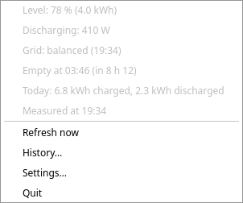
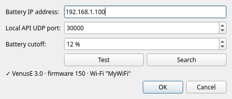
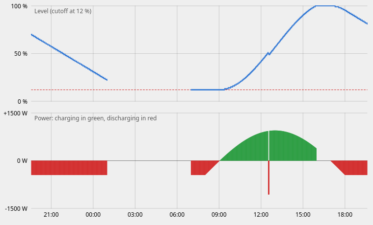

# Marstek Tray

A system tray icon showing the state of a **Marstek Venus E** home battery, the way a laptop shows its own battery.



- A gauge of the usable energy: empty at the battery cutoff (12 % by default), full at 100 %. Red below 30 %, orange below 70 %, green above.
- A green → arrow with a small sun while charging, a red ← arrow while discharging, a green check badge when full.
- On click, a menu with the level (and stored energy in kWh), the charge or discharge power, the power exported to or imported from the grid, when the battery will be full or empty, today's totals (kWh charged and discharged) and the time of the reading.
- A **History…** window with the level and power curves of the last 24 hours.
- Desktop notifications: low battery, battery full, battery unreachable, CT meter disconnected.

One reading per minute, over the battery's local API.

> **Unofficial.** This project is not affiliated with or endorsed by Marstek. It only **reads** the battery state: it never changes any battery setting.

## Requirements

- A Marstek battery with the **local API (Open API) enabled** in the Marstek app. Note the UDP port you choose there (30000 by default).
- The battery on the same local network, ideally with a fixed IP (a DHCP reservation in your router).
- Linux with a system tray that supports StatusNotifierItem, Python 3.9 or later, and PyQt6 (or PyQt5).

Tested with:

| Hardware / system | Status |
|---|---|
| Venus E 3.0, firmware 150 | daily use |
| Debian 13, KDE Plasma 6, Wayland: `sudo apt install python3-pyqt6` | daily use |
| Debian 11, KDE Plasma 5, X11: `sudo apt install python3-pyqt5` | tested |
| GNOME | untested: needs the AppIndicator extension |

Other Marstek models with the same local API (Venus C, Venus D, Venus A…) may work, but have not been tested.

## Installation

```sh
git clone https://github.com/atlantis3001/marstek-tray.git
cd marstek-tray
./install.sh
```

The script checks that the app can start, adds it to the session autostart (`~/.config/autostart/`) and to the application menu as "Marstek Tray", then starts it (or restarts it if it was already running). The app runs straight from this folder: if you move the folder, run `./install.sh` again.

To start it by hand: `python3 marstek_tray.py`. Only one instance runs at a time: a second launch exits silently, so the battery does not receive twice as many requests.

## Uninstallation

```sh
./uninstall.sh
```

Stops the app and removes the autostart and menu entries. The settings (`~/.config/marstek-tray.toml`) and the state files (`~/.local/state/marstek-tray*`: today's totals, history) are kept: delete them by hand to remove everything.

## Settings



The **Settings…** window sets the battery IP address, the UDP port and the battery cutoff. It also opens on its own at first launch.

- **Test** queries the battery at the address you typed, before saving it, and shows its model, firmware and Wi-Fi network.
- **Search** finds the battery on the local network and fills in its IP. The port must be the one chosen in the Marstek app. If several devices answer, a menu lets you pick one.
- **Battery cutoff** is the level at which the battery stops discharging: 12 % with the default DOD of 88 %. Change it if you changed the DOD in the Marstek app. It sets where the gauge is empty and how long the battery will last.

The settings are saved in `~/.config/marstek-tray.toml`:

```toml
host = "192.168.1.100"
port = 30000
cutoff = 12
```

## What the icon shows

| Icon | Meaning |
|---|---|
|  Gauge + sun + green arrow → | charging (more than 10 W) |
|  Gauge + red arrow ← | discharging (more than 10 W) |
|  Green outline + check badge | full (100 %) and idle |
|  Gauge only | idle, or power unavailable |
|  Grey battery with "?" | waiting for the first reading, or battery unreachable twice in a row; the menu then says since when |

## History



**History…** shows the level and the power of the last 24 hours. The readings are kept in `~/.local/state/marstek-tray-history.csv`, so they survive a restart. Readings more than 3 minutes apart are not joined: when the computer sleeps, the app does not read the battery, and the curve shows a gap.

## Notifications

Each notification is sent once: the level has to move 5 % away from the threshold before it can come back. Low thresholds are only notified while discharging, including when the discharge starts below the threshold or when the app starts then.

| Notification | When |
|---|---|
| Battery below 20 % | discharging below 20 % (critical) |
| Battery below 30 % | discharging below 30 % (warning) |
| Battery below 40 % | discharging below 40 % |
| Battery full | the level reaches 100 %. Nothing at startup if the battery is already full. If the maximum charge is limited below 100 % in the Marstek app, this notification never comes. |
| Battery unreachable for 5 min | the battery has not answered for 5 minutes (warning). Once per outage; a single missed reading triggers nothing. |
| Battery reachable again | the battery answers again, only after the previous alert. |
| CT meter disconnected | the battery no longer receives its CT meter, two readings in a row, about 5 minutes (warning). In Auto mode, the battery then no longer follows household consumption. |
| CT meter connected again | the meter is back, after an alert. |

## Troubleshooting

The **Test** button of the settings window is the easiest check. To check without the app:

```sh
echo '{"id":1,"method":"ES.GetStatus","params":{"id":0}}' | socat -T 5 - udp:192.168.1.100:30000
```

| Symptom | Likely cause |
|---|---|
| `Connection refused` | Nothing listens on that port: the local API is not enabled, or the port is wrong. |
| Nothing comes back before the timeout | Wrong IP, or the battery does not answer (restarting, firmware). |
| It answered, then nothing or `Connection refused` | The battery received too many requests in a row and its API stopped answering. Wait a few minutes without querying it. |

## Notes on the Marstek local API

The app speaks JSON-RPC over UDP, as described in Marstek's [Device Open API documentation](https://static-eu.marstekcloud.com/ems/resource/agreement/MarstekDeviceOpenApi.pdf). A few things the documentation does not say, observed on a Venus E 3.0 with firmware 150:

- **Requests must be spaced.** Two requests in a row are often enough for the second one to go unanswered, and a burst of requests makes the API stop answering for a few minutes. The app sends one request per minute and always waits at least 10 s between two requests. An occasional missed reading is normal.
- **`ES.GetStatus` has no `bat_power`.** The app then uses `ongrid_power`, which is **negative while the battery charges** and positive while it powers the house. This was checked against the stored energy rising.
- **`total_grid_input_energy` and `total_grid_output_energy`** (in `ES.GetStatus`) are the energy that went into and out of the battery since commissioning, in Wh. Today's totals are their difference with the first reading of the day, kept in `~/.local/state/marstek-tray.json`.
- **`Marstek.GetDevice`** only answers with `"params": {"ble_mac": "0"}`, both as a broadcast and sent straight to the battery's IP. With `{"id": 0}` it answers `Invalid params`.
- **CT meter state.** `ct_state` in `EM.GetStatus` correctly reports the CT meter as connected, while `ct_state` in `ES.GetMode` stays at 0 with the meter working. The app relies on `EM.GetStatus`.
- **`total_power` in `EM.GetStatus`** is the power exchanged with the grid, **negative while exporting**. This was measured with a full battery in full sun. The meter's cumulative `input_energy` and `output_energy` stay at 0, so there is no daily export total.

One poll out of five (one out of two when the battery is full) sends `EM.GetStatus` instead of `ES.GetStatus`, so the app still sends a single request per minute.

The remaining time ("Empty at 03:40 (in 4 h 20)") uses the average power of the last 10 minutes, keeping only the readings that go in the same direction as the latest one, so that a washing machine cycle does not make it jump at every reading.

## Files

| File | Role |
|---|---|
| `marstek_tray.py` | Entry point: icon, menu, settings window |
| `marstek.py` | UDP client for the local API |
| `alerts.py` | Which notifications to send |
| `daily_energy.py` | Today's charged and discharged totals |
| `history.py` | Readings of the last 24 hours |
| `history_chart.py` | History window |
| `test_*.py` | Tests, including the client against a fake UDP battery |

To run the tests: `python3 -m unittest -v` (add `QT_QPA_PLATFORM=offscreen` without a display).

## License

[GPL-3.0](LICENSE).
